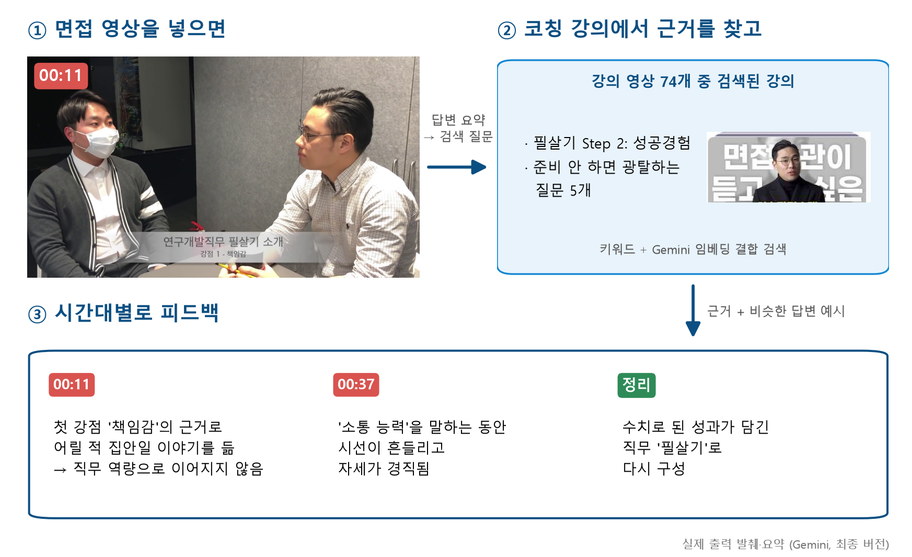
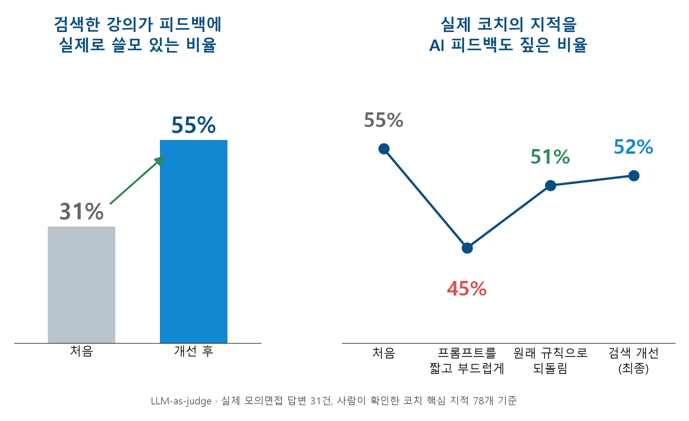

# 🎯 AI 면접 코칭 피드백 서비스 — 코칭 강의를 근거로 붙이는 RAG

<p align="center">
  
  
  
  
  
  
</p>

> 면접 영상(또는 답변 텍스트)을 넣으면, 유튜브 면접 코칭 채널 **"면접왕 이형"** 의 강의에서 근거를 찾아 붙이고
> 영상의 시간대별(`[MM:SS]`)로 코치의 기준에 맞춘 피드백을 줍니다.
>
> SK플래닛 T아카데미 ASAC 과정 프로젝트(2026.02~03)로 시작해, 과정 후 코드로 다시 구현하고 실제 코치 피드백을 정답으로 평가·개선했습니다 (2026.08~10).
> **최종 버전: `07_feedback_v3.ipynb` (v5)**

---

## 💡 한눈에 보기

<p align="center"></p>

| | 처음 (v1) | 최종 (v5) |
|---|---|---|
| 주제 질문에서 그 주제를 다룬 강의를 찾음 (Hit@3) | 0 / 9 | **14 / 14** |
| 검색한 강의 문단이 피드백에 쓸모 있는 비율 (LLM-as-judge, 31쌍) | 31% | **55%** |
| 실제 코치의 핵심 지적을 AI 피드백도 짚은 비율 | 55% | 52% |

<p align="center"></p>

- 검색은 정답 기준 평가로 원인(모의면접 전사 혼입 · 임베딩 128토큰 한계)을 찾아 고쳤습니다 (아래 "v2"·"임베딩 비교")
- 6건만 보고 짧고 부드럽게 고친 프롬프트가 31건 평가에서 코치 지적 재현율을 떨어뜨린 것(55% → 45%)을 찾아 되돌렸습니다 (51%) (아래 "LLM-as-judge")
- 검색 근거가 31% → 55%로 좋아지는 동안 재현율은 51~52%에 머물렀습니다 → **다음 병목은 생성 단계**입니다.

---

## 🏗️ 구조 (최종 v5)

```
[데이터 준비]  data_prep/whisper_전사_답변구간_자르기.ipynb · rag_v2.py · rag_v3.py

 유튜브 코칭 영상 ── Whisper(small, 한국어, 단어 단위 시간) 전사
        ├─ 강의 영상 74개 ── 시간 표기 제거 · 300자 문장 경계 분할 ── 567청크
        │                    └─ gemini-embedding-001 (RETRIEVAL_DOCUMENT) ── ChromaDB  interview_rag_v3
        └─ 모의면접 피드백 영상 ── 피드백 시점 기준 ffmpeg로 답변 구간 자르기 ── 답변-피드백 31쌍
                                   (Few-shot 예시 · 평가 정답)

[서비스]  07_feedback_v3.ipynb

 면접 영상 ── Gemini 파일 업로드
   ① Gemini: 답변 요약 + 검색용 질문 한 문장 작성          (pipeline_v3.rewrite_query 와 같은 방식)
   ② 검색: 키워드(TF-IDF 문자 2~4gram) + Gemini 임베딩 순위 결합(RRF) → 강의 청크 4개   (rag_v3.py)
   ③ 예시: 답변 요약과 비슷한 답변-피드백 5쌍 선택 (키워드 + MiniLM 순위 결합)          (pipeline_v3.py)
   ④ Gemini(gemini-3.5-flash): 영상 + 예시 + 근거 + 프롬프트 규칙 → [MM:SS] 시간대별 피드백
   ⑤ 업로드한 영상은 피드백 생성 후 서버에서 삭제
```

### 왜 데이터를 두 역할로 나눴나
| 데이터 | 역할 | 해결하는 문제 |
|---|---|---|
| `data/feedback_data/` (모의면접 답변-피드백) | **Few-Shot 예시** | 코치 특유의 **말투·판단 방식** |
| `data/rag_data/` (강의) | **RAG 근거** | 강의에 있는 **지식·논리 근거** |

Few-Shot만 쓰면 말투는 비슷한데 내용이 얕고, RAG만 쓰면 내용은 맞는데 코치의 판단 방식이 빠집니다. v1은 두 데이터가 한 DB에 섞여 있어 모의면접 전사가 근거로 검색됐고, v2부터 **강의 영상만** 참고자료로 씁니다.

---

## 🎬 실제 출력 예시 (v5, 영상 입력)

예시에 쓰지 않은 공개 모의면접 영상 1개(연구개발 직무 1분 자기소개)로 `07_feedback_v3.ipynb`의 영상 입력을 실행한 결과입니다 (`gemini-3.5-flash`). 영상과 전체 출력은 저작권·실명 때문에 올리지 않고 발췌만 남깁니다.

- **검색용 질문** (①): 면접 자기소개에서 추상적인 인성적 강점 대신 직무 역량과 구체적 성과를 효과적으로 어필하는 피드백 방법은 무엇인가요?
- **검색된 강의** (②): 준비 안하면 면접 광탈하는 질문 5개 · 필살기 Step 2: 성공경험 · 면접관이 밝히는, 떨지 않는 면접준비 · 입사 후 포부 작성법
- **피드백 발췌** (④):
  > [00:11]부터 첫 번째 강점으로 '책임감'을 제시하며 어릴 적 빨래와 청소를 하고 용돈을 받았던 가정교육 이야기를 들고 나왔습니다. (…)
  > [00:37]부터 언급한 두 번째 강점인 '소통 능력' 또한 마찬가지입니다. (…) [00:40 - 00:54] 구간에서 지원자의 비언어적 태도를 보면 시선이 내리깔리거나 불안정하게 흔들리고, 경직된 자세와 단조로운 어조를 유지하고 있습니다. (…)
  > 본인이 주도했던 연구, 실험, 공모전, 혹은 전공 프로젝트 중 하나를 선택하여 어떤 기술적 문제를 해결하고 어떤 성과(성능 개선율, 수치화된 결과 등)를 냈는지를 첫 문장부터 명확히 던지는 방식으로 자기소개 구조를 재설계해야 합니다.

---

## 🛠️ 기술 스택 (최종)

| 구성 요소 | 기술 |
|---|---|
| **STT** | openai-whisper `small` (한국어, 단어 단위 시간) · ffmpeg (답변 구간 자르기) |
| **생성** | Gemini API `gemini-3.5-flash` (영상 입력, `google-genai`) |
| **임베딩** | `gemini-embedding-001` (문서/질문 구분: RETRIEVAL_DOCUMENT / RETRIEVAL_QUERY) |
| **검색** | ChromaDB + TF-IDF 키워드 검색, 순위 결합 RRF(k=60) |
| **예시 선택** | TF-IDF + `paraphrase-multilingual-MiniLM-L12-v2` 순위 결합 |
| **평가** | 정답 기준 검색 평가(Hit@k) · LLM-as-judge (`claude-sonnet-4-6`, 사람이 확인한 코치 핵심 지적 78개 기준) |

---

## 🚀 빠른 시작

```bash
git clone https://github.com/whdyddls4276/interview_coach.git
cd interview_coach
pip install -r requirements.txt
cp .env.example .env      # .env 에 GOOGLE_API_KEY 입력 (LLM-as-judge 재실행 시 ANTHROPIC_API_KEY도)
```

```
07_feedback_v3.ipynb  →  '텍스트 입력'의 ANSWER 또는 '영상 입력'의 VIDEO_PATH 수정 후 실행
                         (처음 실행 시 Gemini 임베딩으로 interview_rag_v3 구축, 약 $0.02)
```

> API 키는 코드에 직접 넣지 마세요. `.gitignore`에 `.env`가 포함되어 있습니다.

---

## 🔁 v2 — 과정 후 재점검·개선 (2026-10)

검색이 실제로 맞는 근거를 가져오는지 **유사도 점수가 아니라 정답 기준**으로 다시 재 보니, 기존 RAG는 서로 다른 질문에도 같은 문단을 1위로 가져오고 있었습니다 (시간 표기·인사말만 담긴 전사 조각 등). 원인을 데이터와 검색 방식으로 나눠 확인하고 고친 버전입니다. 기존 01~05와 기존 DB는 그대로 두었습니다.

| | v1 (04·05) | v2 |
|---|---|---|
| 참고자료 DB | 영상 전사 33개 (모의면접 전사 포함) | **강의 영상 74개만** (`rag_v2.py`, 시간 표기 제거) |
| 검색 | 임베딩 (MiniLM은 128토큰까지만 읽음) | **키워드(TF-IDF) + 임베딩 순위 결합(RRF)** |
| 프롬프트 | 발표자료 slide19 | slide19 규칙 + 판단 쏠림·형식 보정 (`prompts_v2.py`) |
| 출력 한도 | 1,200~1,500토큰 | 4,096토큰 (thinking 토큰 포함이라 잘림 방지) |

### 평가 (`eval_v2.py` → `eval_results_v2/`)

**검색** — 질문 14개, 정답 = 그 주제를 제목으로 다루는 강의

| | 정답 있는 질문 | Hit@1 | Hit@3 | 같은 문단이 1위로 나온 최대 횟수 |
|---|---|---|---|---|
| v1 기존 DB + 임베딩 | 9 | 0 | **0** | 7 |
| v2 강의만 DB + 임베딩 | 14 | 1 | 1 | 13 |
| **v2 강의만 DB + 키워드·임베딩 결합** | 14 | **9** | **10** | 2 |

데이터만 바꿔서는 거의 오르지 않았고(짧은 청크 하나가 대부분의 질문에서 1위), 검색 방식을 바꾼 것이 결정적이었습니다.

**생성** — `feedback_data` 중 예시에 쓰지 않은 6쌍, 같은 모델(`gemini-3.5-flash`)·같은 예시 5개

| | 구어체 끝맺음 비율 | 평균 길이 | 평가 방향이 코치와 일치 |
|---|---|---|---|
| 실제 코치 피드백 | 0.68 | 606자 | — |
| v1 | 0.10 | 870자 | 4/6 (6건 모두 '부정'으로 평가) |
| v2 | **0.44** | **604자** | 3/6 |

- 말투·분량은 코치에 가까워졌습니다.
- **평가 방향(잘했다/아쉽다)은 개선되지 않았습니다.** 코치가 '혼합'으로 본 답변을 두 버전 모두 '부정'으로 평가합니다 → 남은 과제: 칭찬 사례가 섞인 예시 선택, 더 큰 평가 세트, 영상 입력 평가
- 한계: 6건, 텍스트 입력, 평가 방향은 LLM 판정(`gemini-flash-lite-latest`). 발표 기준 모델 `gemini-3.1-pro`는 무료 등급 한도가 0이라 평가에 쓰지 못했습니다.

### 파인튜닝을 쓰지 않은 이유
- 과정 중 GPT-4.1 mini 파인튜닝(`models/llm_comparison/openAI_튜닝.ipynb`)은 학습까지 성공했지만, 출력 품질이 기대에 못 미치고 텍스트만 입력받아 면접 영상 피드백이 불가능해 Gemini Few-Shot을 택했습니다.
- `gemini_튜닝.ipynb`의 Gemini API 파인튜닝은 `501 UNIMPLEMENTED`로 실행되지 않았습니다 — Gemini API의 튜닝 지원이 2025년에 종료됐습니다.

### 실행
```bash
pip install -r requirements.txt
python -c "from rag_v2 import build_db; build_db()"   # 참고자료 DB v2 구축 (최초 1회)
python eval_v2.py --retrieval                          # 검색 평가 (API 호출 없음)
python eval_v2.py                                      # 검색 + 생성 평가
```
피드백 생성은 `06_feedback_v2.ipynb` (텍스트·영상 입력). 이 노트북은 아래 LLM 판정 결과에 따라 **v4 설정**으로 바꿨습니다. 영상 입력은 테스트 영상 1개로 업로드 → 답변 요약·검색용 질문 → 검색 → `[MM:SS]` 피드백까지 동작을 확인했습니다 (`gemini-3.5-flash`, 결과 파일은 개인 영상이라 레포에 올리지 않음). 업로드한 영상은 피드백 생성 후 서버에서 삭제합니다. 05 노트북의 `client.files.upload(path=...)`는 이전 SDK 인자라 현재 google-genai에서는 `file=`로 바꿔야 동작합니다.

---

## ⚖️ LLM-as-judge — 피드백 정확도 평가 (2026-10)

위 생성 평가는 말투·분량만 쟀습니다. **피드백이 실제 코치와 같은 문제를 짚는지** 재려고 판정 기준을 세워 LLM 판정을 붙였습니다.

### 방법
1. **정답 만들기** — `feedback_data` 31쌍의 실제 코치 피드백에서 핵심 지적(78개)과 전체 평가(잘함/혼합/아쉬움)를 LLM으로 초안 → **사람이 원문과 대조해 확인·수정** (`judge_gold.py`, `judge_gold_full.py` → `eval_results_v2/full/gold.json`)
2. **생성** — 같은 답변에 버전별 피드백 생성. 평가 대상과 같은 영상의 쌍은 예시에서 제외 (`eval_full.py`, `eval_v4.py`)
3. **판정** — Claude(`claude-sonnet-4-6`, 채점 대상 Gemini와 다른 계열)가 버전 이름을 모른 채 판정, 같은 판정을 2번 해 평균·일치율 확인 (`judge_full.py`)

| 판정 기준 | 척도 |
|---|---|
| ① 핵심 지적 재현율 | 코치 지적마다 짚음 1 (같은 문제 + 같은 개선 방향) · 부분 0.5 · 못 짚음 0 |
| ② 평가 방향 일치 | 코치의 전체 평가와 같은지 |
| ③ 지어냄 | 답변에 없는 말·경력·수치를 사실처럼 말했는지 |
| ④ 실행 가능성 | 1 일반론 · 3 무엇을 고칠지는 있으나 방법 모호 · 5 이 답변에 맞춘 수정 방향 |
| (검색) 근거 관련도 | 검색한 문단 4개가 이 답변의 문제를 지적·개선하는 데 쓸모 있는지 0/1 |

### 결과 (31쌍, `eval_results_v2/full/judge_summary.json`, 생성 모델 `gemini-3.5-flash`)

| 버전 | 구성 | 코치 지적 재현율 | 평가 방향 일치 | 검색 근거 관련도 | 지어냄 | 실행 가능성 |
|---|---|---|---|---|---|---|
| v1 | 발표 프롬프트 + 기존 DB 검색 + 무작위 예시 | **55%** | 48% | 31% | 1.5 | 3.42 |
| v2 | 강의 DB·하이브리드 검색 + `prompts_v2`(짧고 덜 비판적) | 48% | 53% | 32% | 2.0 | 3.47 |
| v3 | v2 + 질의 정제 + 비슷한 답변 예시 (`pipeline_v3.py`) | 45% | 44% | **47%** | 2.5 | 3.44 |
| v4 | v3의 검색·예시 + 발표 프롬프트 | 51% | 56% | 47% | 3.5 | 3.39 |
| v5 | v4 + 검색 임베딩만 Gemini로 교체 (`eval_v5.py`, 아래 임베딩 비교) | 52% | **58%** | **55%** | 0.5 | 3.44 |

판정 2회 일치: 재현 판정 25~28/31, 평가 방향 27~30/31 · **지어냄 열은 판정 오류로 쓸 수 없음, 평가 방향은 낮게 쏠려 있음** (아래 "판정 검토")

- **질의 정제(v3)로 검색 근거 관련도가 31% → 47%로 올랐습니다.**
- **`prompts_v2`의 "6~10문장"·"잘한 건 잘했다고"가 재현율을 낮췄습니다.** 코치 평가의 68%가 '아쉬움'인데 덜 비판적으로 썼기 때문입니다. 이 보정은 6건 평가를 보고 넣은 것으로, 31건에서는 역효과였습니다. 발표 프롬프트로 되돌린 v4는 45% → 51%로 회복했습니다.
- **검색이 좋아져도 코치 지적 재현율은 v1(55%)을 넘지 못했습니다.** 텍스트로는 영상 속 태도를 볼 수 없고 판단 기준도 예시에 기대고 있어, 다음 병목은 생성 단계입니다.
- v4는 검색 근거와 평가 방향이 v1~v3 중 가장 낫고 재현율은 v1에 가깝습니다 (`06_feedback_v2.ipynb`). **최종은 여기에 임베딩만 바꾼 v5입니다** (`07_feedback_v3.ipynb`, 아래 임베딩 비교).
- 한계: 31쌍(코치 1명), LLM 판정(아래 검토 참고), 텍스트 입력 기준

### 판정 검토 — LLM 판정을 얼마나 믿을 수 있나 (`full/judge_review.json`)

v4 피드백 10쌍(무작위, 시드 2026)의 Claude 판정을 답변·AI 피드백·코치 원문과 대조해 재검토하고, 판정과 다르게 본 항목은 사람이 최종 확인했습니다. 사람이 전수 판정한 것은 아닙니다.

| 판정 기준 | 결과 | 판단 |
|---|---|---|
| ① 코치 지적 재현율 | 항목 일치 16~17/23 (약 72%), 평균은 검토 51% vs 판정 49% | 항목 단위 오차는 양쪽으로 섞여 **평균은 믿을 만함** |
| ② 평가 방향 | 6/10 일치, 어긋난 4건 모두 분명히 부정적인 피드백을 '혼합'으로 판정 | **한쪽으로 쏠림** → v4 평가 방향 일치가 낮게 잡혔을 수 있음 |
| ③ 지어냄 | ① 19건 중 10건이 정답(코치 피드백)에만 있는 내용("복싱동아리 회장", "유입률 32%")을 AI 피드백이 말한 것으로 착각 ② 정답을 빼고 다시 판정해도(`judge_unsupported.py`, 인용문은 코드로 확인) v4에서 잡은 12건 중 맞음 2 · 애매 1 · 아님 9 (평가·조언 문장까지 잡음) | **쓸 수 없음** |

- 실제 지어냄 예: 텍스트 입력인데 "발성이나 전달력 자체는 나쁘지 않은데"라고 목소리를 평가, 지원자가 하지 않은 퇴사 이유를 단정
- 평가 설계의 한계: 코치는 서류·영상 전체를 보고 말해(정규직 전환, 40% 능률 등) **텍스트 답변만으로는 짚을 수 없는 지적**이 섞여 있습니다. 재현율에 천장이 있어, 검색을 개선해도 52% 근처에서 멈춘 이유 중 하나로 봅니다.
- 다음에 고칠 것: 지어냄 기준 좁히기(위 12건을 시험 세트로) · 평가 방향만 따로 판정 · 지적마다 "텍스트로 짚을 수 있음/없음" 표시 후 재현율 재계산
- `full/human_check.md`(사람 판정표)·`compare_human.py`는 사람 전수 판정용으로 남겨 둠 (미작성)

### 임베딩 비교 — MiniLM → Gemini 임베딩 API (`embed_compare.py`, `eval_v5.py`)

MiniLM은 128토큰까지만 읽어 강의 DB 청크의 89%가 잘려 있었습니다(청크 길이 중앙값 165토큰). Gemini 임베딩 API(문서/질문 구분)로 바꿔 같은 기준으로 비교했습니다. DB 임베딩 비용은 약 $0.02입니다.

| 임베딩 | 주제 질문 14개: 임베딩만 Hit@3 | 키워드 결합 Hit@1 / Hit@3 | v4 검색 질문 31개: 근거 관련도 |
|---|---|---|---|
| MiniLM (기존) | 1 | 9 / 10 | 40% |
| **gemini-embedding-001** (2,048토큰) | **13** | **11 / 14** | **60%** (쌍별 나음 17 · 같음 10 · 못함 4) |
| gemini-embedding-2 (8,192토큰) | 12 | 11 / 13 | 61% |

근거 관련도는 세 모델이 가져온 문단을 쌍마다 모아 한 번에 판정하고 같은 문단에는 같은 판정을 적용했습니다. 위 결과표의 관련도(judge_full, 버전별로 따로 판정)와는 판정 방식이 달라 같은 MiniLM도 40%/47%로 다르게 나옵니다. **같은 표 안에서만 비교합니다.**

- **gemini-embedding-001을 골랐습니다.** 임베딩만으로도 주제 질문을 거의 다 찾고, 근거 관련도는 embedding-2와 비슷하며 더 쌉니다. 청크가 최대 471자라 2,048토큰이면 충분합니다.
- **v5(v4 + gemini-embedding-001 검색)는 근거 관련도가 47% → 55%로 올랐지만 코치 지적 재현율은 51% → 52%로 그대로입니다** (쌍별 나음 6 · 같음 19 · 못함 6). 검색 근거를 31% → 47% → 55%로 올리는 동안 재현율은 51~52%에 머물렀습니다 → **병목은 검색이 아니라 생성 단계**라는 해석을 직접 확인했습니다.
- **v5를 최종으로 씁니다** (`rag_v3.py` → `chroma_db/interview_rag_v3`, `07_feedback_v3.ipynb`). 피드백 정확도는 같지만 근거가 더 정확하고, 청크가 잘리지 않으며, 생성에 이미 Gemini API를 써서 새 의존성이 없습니다. 06(v4, MiniLM)과 `interview_rag_v2`는 그대로 둡니다. 07의 텍스트·영상 입력 동작 확인, 업로드 영상 삭제 확인.

### 평가 중 발견해 고친 데이터 버그
`6~10` 묶음의 인터뷰 파일은 **지원자 답변(A.)과 코치 피드백(F.) 블록이 번갈아** 들어 있습니다. 파일 전체를 답변으로 읽으면 정답인 코치 피드백이 입력에 섞입니다. 이 5쌍은 판정 결과 재현율이 대부분 1.00으로 나와 드러났습니다. `eval_v2.load_pairs`와 `06_feedback_v2.ipynb`는 A 블록만 남기도록 고쳤고, **04·05 노트북의 Few-Shot 예시에는 이 문제가 그대로 남아 있어** (기록용으로 수정하지 않음) 피드백 생성은 07(또는 06)을 쓰세요. 수정 전 결과는 `eval_results_v2/full/*_오염본.json`으로 보관했습니다.

---

## 🗂️ 프로젝트 구조

```
interview-coach/
│
├── 07_feedback_v3.ipynb        ⭐ 최종 (v5) — 강의 DB + 질의 정제 + 키워드·Gemini 임베딩 결합 검색 + 비슷한 답변 예시 (영상·텍스트)
├── 06_feedback_v2.ipynb        v4 — 07과 같고 검색 임베딩만 MiniLM
├── rag_v3.py                   v3 참고자료 DB — 강의 567청크, Gemini 임베딩(gemini-embedding-001) + 키워드 결합 검색
├── rag_v2.py                   v2 참고자료 DB 구축(Whisper 시간 표기 제거·청킹) + 키워드·임베딩(MiniLM) 결합 검색
├── pipeline_v3.py              질의 정제 + 비슷한 답변 예시 고르기
├── embed_gemini.py             Gemini 임베딩 API 호출 (배치)
├── prompts_v2.py               시스템 프롬프트 v1(최종에 사용) / v2(비교용)
├── eval_v2.py                  검색(정답 강의 Hit@k)·생성 평가 → eval_results_v2/
├── eval_v3.py · eval_full.py · eval_v4.py · eval_v5.py   버전별 피드백 생성 (6건 / 31쌍)
├── judge_gold.py · judge_gold_full.py   판정 정답(코치 핵심 지적) 초안 → 사람 확인
├── judge_v2.py · judge_v3.py · judge_full.py   LLM-as-judge 판정
├── judge_unsupported.py        정답 없이 지어냄만 다시 판정 (판정 검토용)
├── embed_compare.py            임베딩 모델 비교 (MiniLM / gemini-embedding-001 / -2)
├── docs/                       README 그림
│
├── data/
│   ├── rag_data/               RAG 근거 — 강의 영상 Whisper 전사 (74개, v1은 1~5의 51개)
│   ├── feedback_data/          Few-Shot 예시·평가 정답 — 모의면접 답변·코치 피드백 전사 (31쌍)
│   └── finetune/               파인튜닝 데이터셋 (jsonl, 기록용)
│
├── data_prep/
│   ├── whisper_전사_답변구간_자르기.ipynb   Whisper 전사(단어 단위 시간) · ffmpeg로 답변 구간 자르기
│   └── LLM용JSON.ipynb          파인튜닝 데이터 생성 (기록용)
│
├── 01_rag_build.ipynb ~ 05_video_feedback.ipynb   v1 (과정 중 버전, 기록용 · 04·05는 예시 데이터 버그 있음)
├── gemini_튜닝.ipynb            Gemini 파인튜닝 시도 (501, 기록용)
└── models/                     과정 중 실험 (기록용)
    ├── llm_comparison/         LLM 비교 (openAI_튜닝.ipynb, vertex_ai.ipynb)
    └── nonverbal/              음성·표정·자세 단독 분석 시도
```

---

## 📦 데이터셋

### RAG 근거 — `data/rag_data/` (강의 영상 74개 → 567청크)
강의 영상의 음성을 Whisper로 전사한 텍스트입니다. `rag_v2.load_chunks()`가 시간 표기와 단어 단위 줄을 지우고 300자(문장 경계, 겹침 50자)로 나눕니다.

| 카테고리 | 파일 수 |
|---|---|
| 1. 핵심 역량(필살기) 구축 및 취업 전략 | 12 |
| 2. 비즈니스 커뮤니케이션 및 답변 스킬 | 8 |
| 3. 면접 단계-유형별 맞춤 공략 | 12 |
| 4. 필수-압박 질문 완벽 방어 | 10 |
| 5. 면접 마인드셋 및 기본 태도 | 9 |
| 6. 추가 강의 (v2에서 추가, 분류 전) | 23 |

### Few-Shot 예시·평가 정답 — `data/feedback_data/` (31쌍)
모의면접 영상을 피드백 시점 기준으로 잘라(ffmpeg) 지원자 답변과 코치 피드백을 각각 전사한 쌍입니다. 최종 코드(07)는 `1~5` / `6~10` / `11~16` 묶음에서 답변과 피드백이 모두 있는 31쌍을 읽습니다.
⚠️ `6~10/text/*인터뷰*.txt`는 답변(A.)과 코치 피드백(F.)이 한 파일에 섞여 있으니, 답변만 쓸 때는 `eval_v2.answers_only()`로 A 블록만 꺼내세요.

---

## 📌 다음 과제

- **생성 단계 개선** — 검색 근거가 좋아져도 재현율이 51~52%에 머묾. 코치의 판단 기준을 예시에만 기대지 않도록 규칙화
- **평가 개선** — 지적마다 "텍스트로 짚을 수 있음/없음"을 표시해 재현율 재계산 · 지어냄 판정 기준 좁히기 · 평가 방향만 따로 판정
- 영상 입력 기준 평가 세트 만들기 (현재 평가는 텍스트 입력 기준)

---

## 📜 기록: 과정 중 버전 (2026.02~03)

과정 중에는 Google AI Studio와 노트북(01~05)에서 예시 → 참고자료 → 프롬프트 규칙을 단계별로 더하며 결과를 비교했습니다. 아래는 그 기록이며, 최종 버전과 수치는 위 내용을 기준으로 합니다.

### 튜닝 진행 과정 (과정 중)
| 단계 | 적용 | 결과 |
|---|---|---|
| 1 | Few-Shot only | 어투는 맞으나 내용이 피상적 |
| 2 | + RAG | 논리·근거 강화 |
| 3 | + 프롬프트 엔지니어링 | 코치 스타일 규칙 9종 적용 (`prompts_v2.SYSTEM_PROMPT_V1`로 최종에도 사용) |
| 4 | + 타임스탬프 규칙 | 영상 입력 대응 |

### v1 구조 (04·05 노트북)
면접 영상 → Gemini가 키워드 추출 → ChromaDB(영상 전사 33개, MiniLM, 786청크) Top-4 검색 → 무작위 Few-Shot 5쌍 + 근거 + 영상 + 프롬프트 → `gemini-3.1-pro-preview`. 모의면접 전사가 근거 DB에 섞여 있고 MiniLM이 청크 앞 128토큰만 읽어, 서로 다른 질문에도 같은 문단을 1위로 가져왔습니다 (위 v2 평가).

### LLM 비교 실험 (`models/llm_comparison/`)
| 모델 | 방식 | 결과 |
|---|---|---|
| Gemini 3.1 Pro | RAG + Few-Shot + 영상 입력 | 과정 중 채택 — 영상 직접 분석 가능 |
| GPT-4.1 mini | 파인튜닝 | 텍스트 한정, 영상 불가 |
| Gemini Flash Lite | RAG + 프롬프트 | 피드백 깊이 부족 |

`gemini-3.1-pro-preview`는 무료 등급 한도가 0이라, 과정 후 재구현·평가는 `gemini-3.5-flash`로 진행했습니다.

### 과정 중 평가 메트릭 (`02_eval_pipeline.ipynb`)
`factpunch`(한줄평 날카로움) · `analysis` · `prescription` · `accuracy` · `context_relevance` · `keyword_hit_rate` — 정답 없이 LLM이 1~5점을 매기는 방식이라, 과정 후에는 실제 코치 피드백을 정답으로 두는 평가(위 LLM-as-judge)로 바꿨습니다.
